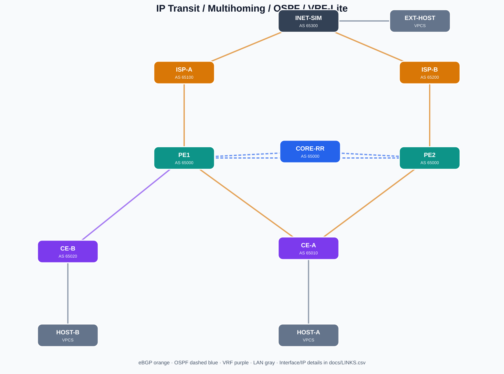

# IP Transit Multihoming — EVE-NG CE

> Изолированная учебная сеть: два upstream, OSPF, iBGP Route Reflector, клиентский BGP multihoming, фильтрация анонсов и VRF-Lite. Не является копией сети какого-либо оператора.

## Состав

| Роль | Устройства | ASN / сеть |
| --- | --- | --- |
| Оператор IP Transit | PE1, CORE-RR, PE2 | AS65000; OSPF area 0 и iBGP |
| Upstream A / B | ISP-A, ISP-B | AS65100, AS65200 |
| Условный Internet | INET-SIM и EXT-HOST | AS65300; 198.51.100.0/24 |
| Dual-homed клиент | CE-A и HOST-A | AS65010; 203.0.113.0/24 |
| Локальный клиент VRF | CE-B и HOST-B | AS65020 условно; VRF CUST_B, 192.0.2.0/24; **без BGP** |

**8 Cisco IOSv + 3 VPCS**, 13 мостов. Все ASN — частные; LAN-префиксы взяты из документационных диапазонов RFC 5737. Не подключайте лабораторию к production/internet bridges и не экспортируйте тестовые маршруты наружу.

- **Готовый `.unl` содержит встроенные startup-config восьми маршрутизаторов** (`config="1"` плюс base64 в `<objects><configs>`). Тот же текст доступен в `configs/`.
- VPCS `EXT-HOST`, `HOST-A`, `HOST-B` вводятся вручную из `vpcs/*.txt` и сохраняются командой `save`.
- На PE1/PE2/CORE-RR OSPF образует треугольник, iBGP PE1/PE2 установлены к loopback CORE-RR (RR).
- PE1 предпочитает входящий путь к EXT через ISP-A с `local-preference 200`; PE2 может предпочесть отражённый путь через PE1.
- CE-A предпочитает PE1 через локальный Cisco `weight 200`.
- BGP prefix-lists ограничивают исходящий анонс клиента `203.0.113.0/24` и принимаемый извне `198.51.100.0/24`.
- CE-B подключён к **VRF CUST_B только на PE1**; `192.0.2.0/24` изолирована от глобальной RIB. Это VRF-Lite, **не MPLS L3VPN**.

## Установка

1. Проверьте на EVE-NG имя каталога с IOSv: `ls -1 /opt/unetlab/addons/qemu/ | grep '^vios-'`.
2. Если имя отличается от `vios-adventerprisek9-m.SPA.159-3.M6`, выполните `python3 tools/rewrite_image.py --image vios-ВАШ_КАТАЛОГ`. Полученный `IP-TRANSIT-MULTIHOMING-local.unl` использовать вместо оригинала. Изменять `image` на образ другого типа без смены template и CLI нельзя.
3. Загрузите новый файл на EVE: `scp IP-TRANSIT-MULTIHOMING.unl root@<EVE_IP>:/opt/unetlab/labs/`. Затем на сервере `/opt/unetlab/wrappers/unl_wrapper -a fixpermissions`.
4. Откройте лабораторию в Web UI, запустите роутеры. Если startup-config не подхватились на вашей версии EVE, примените `configs/*.cfg` вручную, проверив интерфейсные имена и сохранение.
5. Запустите VPCS и выполните команды из `vpcs/`.
6. Проверки: `show ip ospf neighbor`, `show ip bgp summary`, `show ip bgp 198.51.100.0`, `show ip bgp 203.0.113.0`; с HOST-A `ping 198.51.100.10`, с EXT-HOST `ping 203.0.113.10`. Для VRF: `show ip route vrf CUST_B`, `ping vrf CUST_B 192.0.2.10 source 10.20.0.9`.

## Документы

- [LINKS.csv](docs/LINKS.csv) — строгий план линков, интерфейсов и подсетей.
- [EXERCISES.md](scenarios/EXERCISES.md) — 8 лабораторных сценариев с rollback.
- [DIAGNOSTICS.md](docs/DIAGNOSTICS.md) — последовательность troubleshooting.
- [MULTIVENDOR.md](docs/MULTIVENDOR.md) — замена CE-A на Junos и RouterOS v7.
- [rewrite_image.py](tools/rewrite_image.py) — адаптация имени IOSv image.
- [validate_lab.py](tools/validate_lab.py) — структурный offline-check.

## Статус и ограничения

Выполнена генерация и структурная проверка модели; **живой запуск IOSv на EVE-NG не проводился**. Доступность отдельных Cisco CLI-команд и чтение embedded startup-config зависят от версии образа/платформы. Лаборатория не моделирует реальную DDoS-очистку, RTBH/FlowSpec, RPKI/ROV и не заменяет полноценную L3VPN. Ресурсы QEMU: 8×768 MiB ≈ 6 GiB гостевой RAM; EVE-хосту требуется дополнительный запас памяти и CPU.
