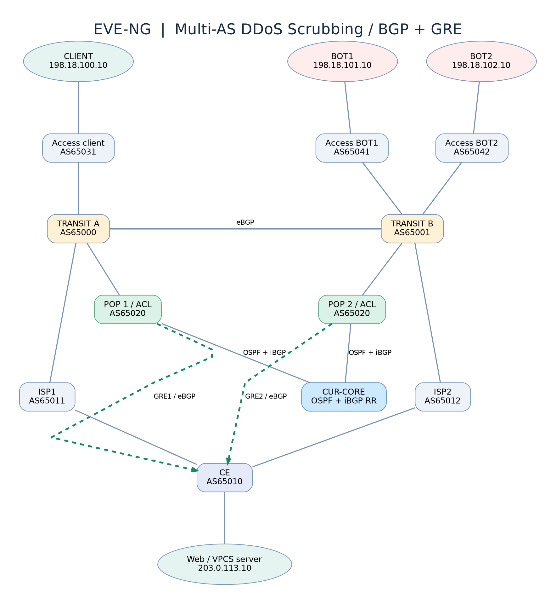

# CURATOR-style Multi-AS BGP/GRE Lab v3.1 — EVE-NG CE

> **Цель:** исследовать подключение сети заказчика к распределённому оператору DDoS-защиты через **BGP + GRE**, с несколькими транзитными AS, двумя независимыми ISP, двумя POP очистки и iBGP между POP.
>
> Это **учебная модель принципа** услуги CURATOR, **не** официальная топология CURATOR и **не** реальная anti-DDoS-система. ACL только демонстрирует расположение точки фильтрации.



## Исправление v3.1: startup-config IOSv

В исходной v3 в `.unl` был только граф сети (`config="0"`); отдельные `configs/*.cfg` автоматически не применялись. Теперь **в единственный файл `CURATOR-BGP-MULTIAS-V3.unl` встроены 11 startup-config (Base64 в `<objects><configs>`)** с `config="1"` на IOSv. Файл проверяется командой:

```bash
python3 tools/check_startup.py
```

При изменении любого `configs/*.cfg` пересобрать встроенные конфигурации и перепроверить:

```bash
python3 tools/embed_startup.py
python3 tools/check_startup.py
```

**ВНИМАНИЕ:** в старом ZIP v3.1 находились *два* `.unl`, один был старым пустым вариантом. Не импортируйте из него `CURATOR-BGP-MULTIAS-V3.unl`. Файл в этом репозитории исправлен; он является единственным рекомендованным `.unl`.

### Загрузка в EVE-NG CE

1. Скопировать `CURATOR-BGP-MULTIAS-V3.unl` в `/opt/unetlab/labs/` под новым именем, не заменяя действующую лабораторию.
2. В EVE-NG открыть **Startup-configs** и убедиться, что у 11 IOSv есть сохранённая конфигурация и она включена (**ON**).
3. Если роутеры уже были запущены со старой NVRAM, остановить и выполнить **Wipe только для этих роутеров новой лаборатории** (Wipe удаляет состояние), затем запустить.
4. Проверить `show running-config | include hostname` и `show ip interface brief` (например, на CE — `hostname R-CE`).
5. Четыре VPCS не используют встроенные IOSv startup-config: выполнить соответствующие `vpcs/*.txt` и `save`.

**Проверен формат UNL и соответствие конфигураций, но фактический запуск на пользовательском EVE-NG CE не подтверждён.**

## Отличия от v2

- **AS65000 и AS65001:** два независимых транзитных оператора, объединённых eBGP; клиент подключён через AS65031, два тестовых источника — через AS65041/65042.
- **AS65020:** CUR1/CUR2 подключены к разным транзитным AS; внутри — **OSPF + iBGP Route Reflector** `R-CUR-RR`. При потере GRE1 POP1 может переслать пакет внутри своей AS на POP2, если тот сохранил связь с CE.
- **AS65011/65012:** два underlay ISP с eBGP к CE. IP GRE-эндпоинтов достигаются через провайдеров; `/32` статические маршруты на CE специально привязывают подложку к разным ISP и предотвращают рекурсию GRE.
- **Антиобход:** защищаемый `/24` не экспортируется к обычным ISP в базовом сценарии. Добавлены фильтры префиксов и тест ошибочной публикации `/24` напрямую.
- **Опциональные Linux-хосты:** настоящий HTTP/80, curl, MTU/MSS и захваты трафика. Базовая `.unl` использует VPCS, чтобы работать без Linux-образов.

## Состав

| Роль | Устройства | ASN |
|---|---|---|
| Transit A / Transit B | `R-T1`, `R-T2` | `65000`, `65001` |
| Оператор очистки | `R-CUR1`, `R-CUR2`, `R-CUR-RR` | `65020` |
| Underlay ISP | `R-ISP1`, `R-ISP2` | `65011`, `65012` |
| Заказчик | `R-CE`, `SERVER` | `65010` |
| Access AS клиента | `R-ACCESS-CLIENT`, `CLIENT` | `65031` |
| Access AS тестовых источников | `R-ACCESS-BOT1/BOT2`, `BOT1/BOT2` | `65041`, `65042` |

Итого: **11 Cisco IOSv L3 + 4 VPCS**, **16 L2-мостов point-to-point**. Ориентировочная память хоста EVE VM: **10–12 ГБ и более**, для Linux-варианта желательно **12–16 ГБ и более** в зависимости от QEMU-образов.

Тестовые сети: `203.0.113.0/24` (защищаемый сервер `203.0.113.10`), `198.18.0.0/15` (отдельные LAN и GRE endpoint), `10.1.0.0/24` (внешние p2p), `10.2.0.0/24` (внутренний backbone), `172.31.1.0/30` и `172.31.2.0/30` (GRE). Все ASN в этой лаборатории — частные. **Не анонсируйте тестовые префиксы во внешние сети.**

## Установка в EVE-NG CE

1. На EVE-NG (`192.168.0.100`) проверьте **реальное имя** каталога с образом IOSv:
   ```bash
   ls -1 /opt/unetlab/addons/qemu/ | grep '^vios-'
   ```
2. На компьютере, где распакован архив, из каталога лаборатории пересоберите `.unl` с точным именем образа (образ в архив **не включён**):
   ```bash
   # При отличающемся имени IOSv заменить image="..." на имя каталога образа в .unl
   python3 tools/check_startup.py
   ```
3. Перенесите `.unl` в **новый файл** на сервер EVE, не перезаписывая предыдущую лабораторию:
   ```bash
   scp CURATOR-BGP-MULTIAS-V3.unl root@192.168.0.100:/opt/unetlab/labs/
   ```
4. На сервере (при необходимости; изменяет права файлов EVE):
   ```bash
   /opt/unetlab/wrappers/unl_wrapper -a fixpermissions
   ```
5. В EVE-NG откройте Startup-configs и проверьте наличие и включение ON всех 11 конфигураций; для уже запусканных устройств выполните Wipe только этих устройств, затем Start. Для VPCS примените `vpcs/*.txt` и `save`.

**Важное замечание для EVE-NG CE:** атрибут `config` присутствует у всех узлов; у IOSv — `1`, у VPCS — `0`. Файл проверен как XML, но **запуск на конкретном сервере и версии CE не тестировался**. Если ваша сборка использует другой формат, сравните с экспортом короткой рабочей лаборатории на том же EVE.

## Что происходит с маршрутом

```text
CLIENT → AS65031 → AS65000 → CUR1 → GRE1 → CE → SERVER
BOT1/2 → AS65041/42 → AS65001 → CUR2 → GRE2 → CE → SERVER
```

При потере GRE1:

```text
CLIENT → AS65031 → AS65000 → CUR1 → OSPF backbone → CUR2 → GRE2 → CE
```

Маршрут `203.0.113.0/24` получает CE и отдаёт по **двум eBGP-сессиям поверх GRE**. Оба POP через **iBGP и RR** могут знать маршрут, а `next-hop-self` на POP предотвращает передачу в iBGP недоступного next hop GRE клиента. Выход наружу происходит через соответствующую транзитную AS.

**Underlay/Overlay разделены:** CE не отправляет защищаемый префикс ISP1/ISP2; GRE endpoint CUR1 `198.18.0.21/32` закреплён за ISP1, CUR2 `198.18.0.22/32` — за ISP2. Внешняя сеть маршрутизирует только GRE-транспорт, сам `/24` приходит через SCRUB POP.

## Первые проверки (в правильном порядке)

```ios
show ip interface brief
show ip ospf neighbor
show ip route 198.19.0.200
show ip bgp summary
show ip bgp 203.0.113.0
show ip route 203.0.113.10
show interface Tunnel1
show interface Tunnel2
show access-lists SCRUB-POLICY
```

Базовые ожидаемые AS_PATH к `203.0.113.0/24`:

| Точка наблюдения | Основной AS_PATH |
|---|---|
| R-T1 | `65020 65010` |
| R-T2 | `65020 65010` |
| R-ACCESS-CLIENT | `65000 65020 65010` |
| R-ACCESS-BOT1/BOT2 | `65001 65020 65010` |

Перед тестированием ICMP убедитесь, что четыре VPCS имеют адреса из `vpcs/`. CLIENT должен получать ответ от SERVER; ICMP от BOT1/BOT2 блокируется учебной ACL POP. Для real HTTP см. `linux/SETUP.md`.

## Практические сценарии

1. [`00-BASELINE.md`](scenarios/00-BASELINE.md) — проверка BGP, GRE, OSPF/RR, AS_PATH и PCAP.
2. [`01-GRE-FAILOVER.md`](scenarios/01-GRE-FAILOVER.md) — отказ GRE1 и **forwarding CUR1→RR→CUR2→GRE2**.
3. [`02-TRANSIT-FAILOVER.md`](scenarios/02-TRANSIT-FAILOVER.md) — отказ стыка POP1 с Transit A.
4. [`03-BYPASS-LEAK.md`](scenarios/03-BYPASS-LEAK.md) — преднамеренный обход фильтрации из-за прямого анонса `/24` через ISP1, затем восстановление политики.
5. [`04-RETURN-PATH.md`](scenarios/04-RETURN-PATH.md) — асимметричный ответ и дополнительная проверка PBR.
6. [`05-MTU-WEB.md`](scenarios/05-MTU-WEB.md) — Linux HTTP, GRE-инкапсуляция, MSS/MTU.

### Linux-версия

При наличии `linux-*` QEMU-образа генерируется отдельный вариант `.unl`, заменяющий VPCS **CLIENT, BOT2 и SERVER** на Linux. Имя настоящего образа передаётся через `--linux-image`, сетевые адреса и HTTP-сервер настраиваются вручную; см. [`linux/SETUP.md`](linux/SETUP.md).

## Ограничения и дальнейшие улучшения

- Реальные алгоритмы защиты от volumetric/L7 DDoS, Anycast, глобальная топология интернета, BNG/CGNAT, RPKI/ROV, RTBH и FlowSpec **не эмулируются**.
- Между T1 и T2 только один eBGP-стык; это **не полностью отказоустойчивый глобальный интернет**. В частности, при его потере некоторые сети перестанут видеть резервный POP.
- CE по умолчанию предпочитает возврат через GRE1; для клиентов, чей запрос пришёл через GRE2, **обратный путь может быть асимметричным**. Опциональный PBR дан как упражнение, а не как готовое production-решение.
- GRE без IPsec не шифрует трафик. Для реального внедрения также проверяются MTU/PMTUD, потери, TTL, ACL underlay и защита маршрутизации.
- Для сходимости нельзя полагаться только на `interface Tunnel up/up`: контролируйте реальный BGP/forwarding и PCAP. BFD зависит от образа и здесь по умолчанию не включён.
- Последовательность CLI в `configs/` и результаты работы IOSv **не проверены на реальном образе**. Возможны различия синтаксиса и поддержки функций. XML, взаимность соседств и адресация проверены статически.

Ссылки: [CURATOR — BGP-подключение](https://docs.curator.pro/connect/bgp.html) · [EVE-NG CE docs](https://www.eve-ng.net/index.php/documentation/).
