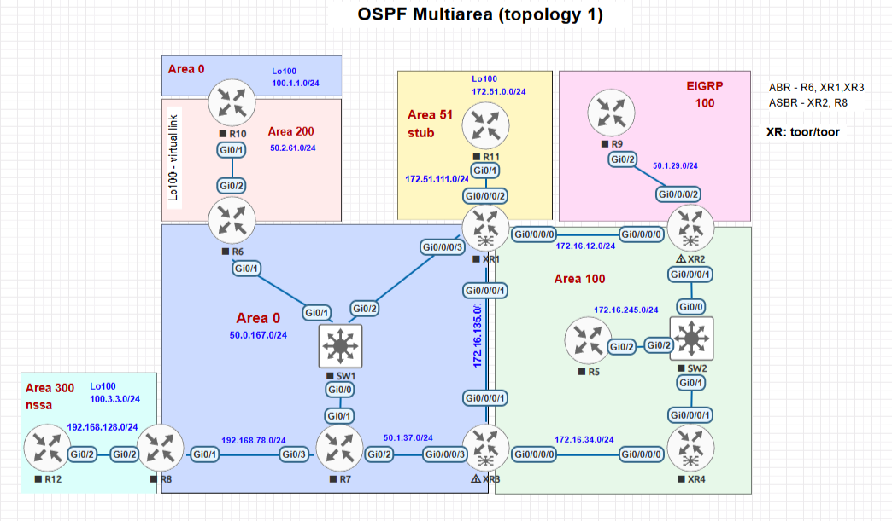

# OSPF Multiarea (topology 1) — EVE-NG

Лаборатория для изучения многообластного OSPF на Cisco IOSv и IOS XRv: backbone area 0, ABR, virtual link, stub/NSSA, аутентификация соседств и взаимная маршрутизация с EIGRP.

**Состав:** 14 устройств (8 IOSv, 4 IOS XRv, 2 IOSvL2), 15 сетевых сегментов. В исходном `ospf_multiarea.unl` у всех 14 узлов задан `config="1"` и присутствуют 14 встроенных startup-config.

**Статус:** это документация к существующей лаборатории. `.unl`, конфигурации и изображение топологии не изменялись. Проверка структуры файла выполнена по содержимому GitHub; фактический запуск устройств и установление соседств в EVE-NG не проверялись.

## Топология



[Открыть схему PNG](Topology.png) · [Открыть лабораторию EVE-NG](ospf_multiarea.unl)

В стенде используются R5–R12 (IOSv), XR1–XR4 (IOS XRv) и SW1/SW2 (IOSvL2). SW1 и SW2 обеспечивают общие Ethernet-сегменты; их не следует считать OSPF-маршрутизаторами.

## Что реализовано в исходных конфигурациях

| Область / протокол | Устройства и назначение |
|---|---|
| OSPF area 0 | Магистральная область с участием XR1, XR3, R6, R7, R8 |
| OSPF area 100 | Часть топологии XR1–XR4 и R5; связь с backbone через ABR |
| OSPF area 51 | Stub-область между XR1 и R11 |
| OSPF area 200 | Транзитная область между R6 и R10; настроен virtual link для логического подключения R10 к backbone |
| OSPF area 300 | NSSA между R8 и R12; на R12 настроено `redistribute connected subnets` |
| EIGRP AS 100 | XR2 и R9; на XR2 настроена взаимная редистрибуция между OSPF и EIGRP |

Также в конфигурациях присутствуют OSPF MD5-аутентификация, key-chain и изменённые hello/dead-параметры на отдельных соединениях. Это описание **настроек в файлах**, а не утверждение, что все соседства и редистрибуция уже проверены в работающем стенде.

## Файлы лаборатории

| Файл | Назначение |
|---|---|
| [`ospf_multiarea.unl`](ospf_multiarea.unl) | Исходная топология EVE-NG со встроенными startup-config для 14 устройств |
| [`Topology.png`](Topology.png) | Исходная схема топологии |
| [`R5.txt`](R5.txt), [`R6.txt`](R6.txt), [`R7.txt`](R7.txt), [`R8.txt`](R8.txt) | Конфигурации IOSv R5–R8 |
| [`R9.txt`](R9.txt), [`R10.txt`](R10.txt), [`R11.txt`](R11.txt), [`R12.txt`](R12.txt) | Конфигурации IOSv R9–R12 |
| [`XR1.txt`](XR1.txt), [`XR2.txt`](XR2.txt), [`XR3.txt`](XR3.txt), [`XR4.txt`](XR4.txt) | Конфигурации IOS XRv |
| [`SW1.txt`](SW1.txt), [`SW2.txt`](SW2.txt) | Сохранённые файлы коммутаторов; `SW2.txt` пуст |

Отдельные `.txt` — файлы для просмотра и ручной настройки. При импорте EVE-NG использует встроенные в `.unl` startup-config, а не автоматически подхватывает соседние `.txt`. Не предполагается, что эти два источника конфигураций были автоматически сверены.

## Быстрый старт

1. Подготовьте EVE-NG CE и совместимые, легально полученные QEMU-образы. В `.unl` указаны следующие имена папок:
   - IOSv: `vios-adventerprisek9-m.SPA.159-3.M6`
   - IOSvL2: `viosl2-adventerprisek9-m.ssa.high_iron_20200929`
   - IOS XRv: `xrv-k9-demo-6.3.1`
2. Загрузите `ospf_multiarea.unl` на сервер. Например, с компьютера с настроенным SSH (замените `EVE_HOST` на адрес сервера):

   ```bash
   scp ospf_multiarea.unl root@EVE_HOST:/opt/unetlab/labs/
   ssh root@EVE_HOST '/opt/unetlab/wrappers/unl_wrapper -a fixpermissions'
   ```

3. Откройте лабораторию `ospf_multiarea` в веб-интерфейсе EVE-NG. Проверьте наличие нужных образов и содержимое **Startup-configs**, включите применение сохранённых конфигураций до первого запуска.
4. Запустите устройства, дождитесь загрузки IOSv/IOS XRv и проверьте реальные соседства и таблицы маршрутизации командами ниже.

**Ресурсы:** суммарно в `.unl` назначено 22 ГиБ RAM гостевым узлам (8 × 1 ГиБ IOSv, 2 × 1 ГиБ IOSvL2, 4 × 3 ГиБ XRv). Дополнительно нужна память для EVE-NG и гипервизора. Образы устройств в репозиторий не входят.

**Важно:** если лаборатория уже запускалась, виртуальные диски могут содержать прежнюю NVRAM. `Wipe` удаляет сохранённое состояние устройств; до применения сохраните собственные изменения.

## Проверка работы

Команды ниже предназначены для **ручной проверки после запуска**, а не являются результатом уже проведённого тестирования.

| Что проверить | Cisco IOSv | Cisco IOS XRv |
|---|---|---|
| OSPF-соседства | `show ip ospf neighbor` | `show ospf neighbor` |
| Интерфейсы и области OSPF | `show ip ospf interface brief` | `show ospf interface brief` |
| База LSDB | `show ip ospf database` | `show ospf database` |
| OSPF-маршруты | `show ip route ospf` | `show route ospf` |

Последовательность проверки:

1. **Area 0 и ABR:** убедитесь, что поднялись соседства между backbone-узлами и что на ABR видны маршруты к другим областям.
2. **Virtual link:** на R6 и R10 выполните `show ip ospf virtual-links`; проверьте состояние связи через area 200.
3. **Stub / NSSA:** проверьте LSDB area 51 (XR1, R11) и area 300 (R8, R12), в том числе поведение внешних маршрутов после редистрибуции connected.
4. **OSPF ↔ EIGRP:** на R9 проверьте `show ip eigrp neighbors` и `show ip route`; на XR2 проверьте соседство и маршруты обеих протокольных областей. Учитывайте различия в синтаксисе IOSv и IOS XRv.
5. **Доступность:** используйте `ping` между Loopback-адресами разных областей и `traceroute` для проверки фактического пути.

Если соседства не устанавливаются, сначала сверьте IP-адресацию, area, тип области, authentication/key-chain, таймеры Hello/Dead и интерфейсные подключения по `Topology.png` и файлам конфигураций.

## Ограничения

- Конфигурации и `.unl` сохранены без исправлений и нормализации. В том числе пустой `SW2.txt` не заполнялся.
- Наличие startup-config в XML подтверждено статически, но **не гарантирует** их успешного применения к выбранным версиям образов и корректного обмена маршрутами.
- Документация не меняет параметры OSPF, EIGRP, список узлов, соединения и адресацию.

[← Все лаборатории OSPF](../README.md) · [← Раздел MPLS для сравнения оформления](../../../MPLS/README.md)
