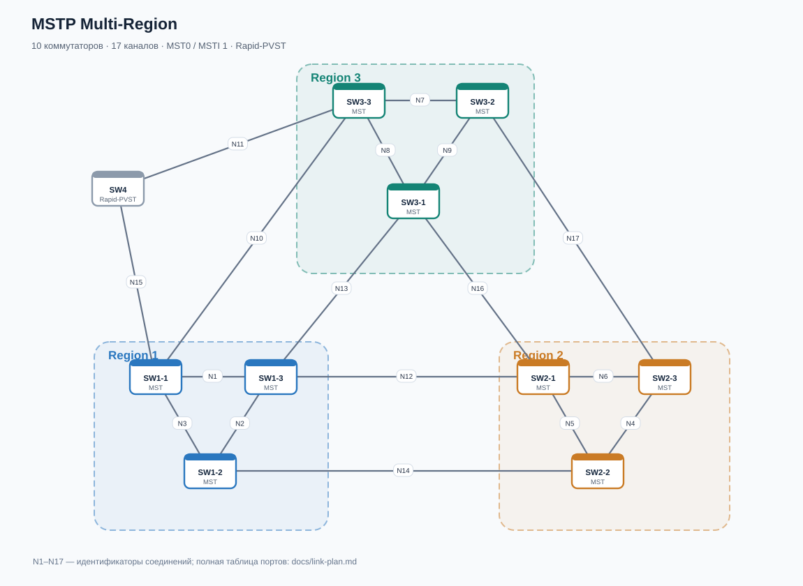

# MSTP Multi-Region — EVE-NG

Лабораторная работа по **Multiple Spanning Tree Protocol (MSTP / IEEE 802.1s)**: три независимых MST-региона, общий CIST, внутренние деревья MSTI, граничные порты и совместимость с **Rapid-PVST+**. Топология восстановлена из исходного `mstp_multi_region(1).unl`; все исходные 10 узлов, 17 линков, приоритеты и стоимость путей сохранены.



## Быстрый старт

1. Скачайте [MSTP-Multi-Region.unl](MSTP-Multi-Region.unl) и импортируйте в EVE-NG (или скопируйте в `/opt/unetlab/labs/`).
2. Требуется совместимый образ **IOSvL2**, в исходнике: `viosl2-adventerprisek9-m.ssa.high_iron_20200929`. Образ в репозитории отсутствует. Для 10 узлов по 1024 МБ потребуется не менее ~10 ГБ RAM только для ВМ.
3. Проверьте в **Startup-configs**, что конфигурации присутствуют и автозагрузка включена (`config="1"` и Base64-конфигурации уже встроены в `.unl`). Установите исправленные права, если импортировали через SCP: `/opt/unetlab/wrappers/unl_wrapper -a fixpermissions`.
4. Запустите коммутаторы и на `SW1-1` выполните `show spanning-tree mst 0` и `show spanning-tree mst 1`. На `SW4` — `show spanning-tree summary`.
5. Проверьте роль каждого порта и границы регионов по [сценариям](scenarios/README.md). Все интерфейсы и номера линков — в [плане соединений](docs/link-plan.md).

Если запускали лабораторию до импорта новых startup-config, после сохранения нужных данных может потребоваться **Stop → Wipe → Start**: Wipe удаляет текущее состояние виртуального диска/NVRAM.

## Состав

| Область | Узлы | MST region name | Наименьший заданный bridge priority MST0/MSTI1 |
|---|---|---|---|
| Region 1 | SW1-1, SW1-2, SW1-3 | `region1` | SW1-1 (0) |
| Region 2 | SW2-1, SW2-2, SW2-3 | `region2` | SW2-3 (8192) |
| Region 3 | SW3-1, SW3-2, SW3-3 | `region3` | SW3-2 (4096) |
| Внешний домен | SW4 | `Rapid-PVST` | По умолчанию (32768 + VLAN ID) |

В каждом MST-регионе: `revision 1`, **MSTI 1 → VLAN 10,20,30**. VLAN 1 относится к MSTI 0, остальная область соответствия VLAN–MSTI не менялась. На всех коммутаторах явно созданы VLAN 10/20/30, на транках разрешены VLAN 1,10,20,30. `SW4` работает в режиме `rapid-pvst` и подключён к `SW1-1` и `SW3-3`. Он не является частью MST-региона.

**Важно:** MSTI 0/IST внутри региона, CIST между регионами и PVST Simulation на границе — не тождественные понятия. Настроенные приоритеты формируют исходные предпосылки, но фактические CIST root, regional root, роли портов и блокировки определяйте по выводам устройств после сходимости. В каждом MST-регионе сейчас только **один** пользовательский MSTI: разные пути для VLAN 10/20/30 в исходном варианте *не* реализованы.

## Что восстановлено и улучшено

- Сохранена геометрия EVE-NG, конфигурации всех десяти устройств и 17 соединений из присланного файла.
- Исправлено несоответствие подписи **Rapid-PVST** и режима `pvst` на SW4.
- Добавлены реальные VLAN 10/20/30, явная общая ревизия региона, список разрешённых VLAN для trunk.
- Настройки узлов продублированы в `configs/*.cfg` для ручной загрузки и ревью; в `.unl` они уже есть.
- Добавлены SVG-схема, план портов, сценарии лабораторных задач и автономная проверка структуры.

## Диагностика

На MST-коммутаторе:
```text
show spanning-tree mst configuration
show spanning-tree mst 0
show spanning-tree mst 1
show spanning-tree mst interface gigabitEthernet0/0 detail
show interfaces trunk
show vlan brief
show spanning-tree inconsistentports
```

На SW4:
```text
show spanning-tree summary
show spanning-tree vlan 1
show spanning-tree vlan 10
show spanning-tree inconsistentports
```

**Ограничение:** в топологии нет хостов; подтверждение передачи пользовательского трафика потребует добавить конечные устройства/тестовые access-порты. Включённые VLAN не означают автоматически успешные ping. Файлы проверены на структурную согласованность; запуск на реальном EVE-NG и фактическая сходимость **не проверены**.

## Материалы

- [Файл EVE-NG](MSTP-Multi-Region.unl) и [конфигурации](configs/)
- [Схема SVG](topology.svg) и [соединения](docs/link-plan.md)
- [Практические сценарии](scenarios/README.md)
- [Проверка структурной целостности](tools/validate_lab.py)

Основание для диагностики границы с Rapid-PVST+: [Cisco PVST Simulation on MST Switches](https://www.cisco.com/c/en/us/support/docs/lan-switching/multiple-instance-stp-mistp-8021s/116464-configure-pvst-00.html).
