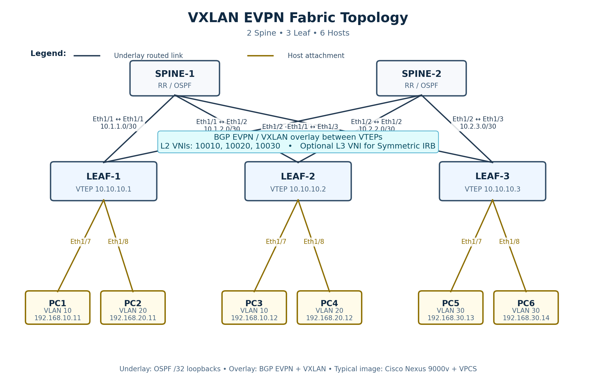

# VXLAN — лаборатории EVE-NG

Здесь размещаются независимые лабораторные работы по VXLAN. Каждая лаборатория находится в собственной папке вместе с топологиями EVE-NG, конфигурациями, схемами, заданиями и материалами для диагностики.

## Каталог лабораторий

| Лаборатория | Содержание | Статус |
|---|---|---|
| [VXLAN-FABRIC](VXLAN-FABRIC/README.md) | Leaf–Spine fabric: 2 Spine, 3 Leaf (VTEP), 6 VPCS; OSPF, BGP EVPN, L2/L3 VNI, Anycast Gateway, Symmetric IRB, два VRF, firewall и 13 сценариев диагностики | Startup-config встроены в основные `.unl`; статические проверки, запуск в EVE-NG CE не подтверждён |

**Быстрый старт:** [инструкция по импорту](VXLAN-FABRIC/README.md#требования-и-установка) · [топология EVPN L2](VXLAN-FABRIC/VXLAN-FABRIC-5N-6H.unl) · [сценарии](VXLAN-FABRIC/scenarios/README.md) · [SVG-схема сети](VXLAN-FABRIC/vxlan-fabric-topology.svg).

### Топология VXLAN-FABRIC

Другие варианты стенда: [Multitenancy без firewall](VXLAN-FABRIC/VXLAN-FABRIC-MULTITENANT-NOFW.unl) · [с IOSv/ACL](VXLAN-FABRIC/VXLAN-FABRIC-MULTITENANT-IOSV-FW.unl) · [с Linux firewall](VXLAN-FABRIC/VXLAN-FABRIC-MULTITENANT-FW.unl).

Для новых VXLAN-лабораторий создавайте отдельные соседние папки, не смешивая их материалы с `VXLAN-FABRIC`.
