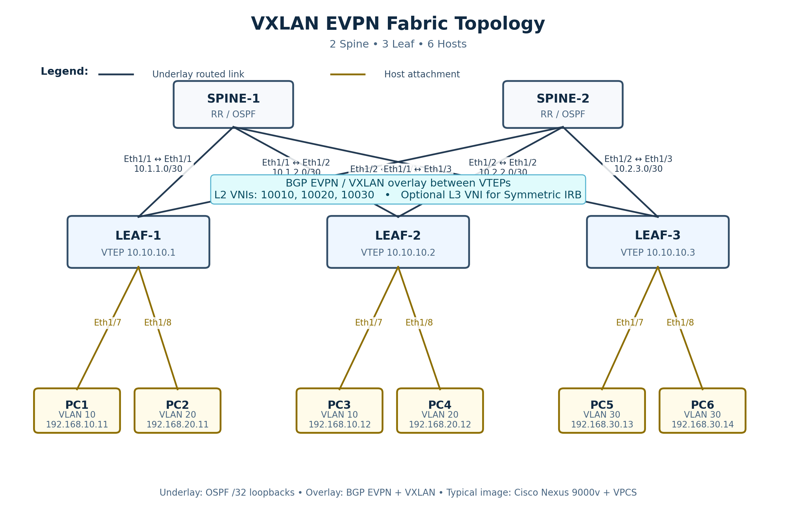

# VXLAN-FABRIC — Leaf–Spine EVPN для EVE-NG CE

Лабораторная IP-fabric на **2 Spine, 3 Leaf (VTEP) и 6 VPCS**. Поддерживает OSPF underlay, BGP EVPN overlay, L2 VNI, Symmetric IRB, L3 VNI и изоляцию VRF. Для межсегментного доступа предусмотрены варианты с маршрутизатором IOSv/ACL и Linux firewall.



[Схема SVG](vxlan-fabric-topology.svg) · [Схема с firewall (PNG)](vxlan-multitenant-fw-topology.png) · [SVG с firewall](vxlan-multitenant-fw-topology.svg)

## Файлы лаборатории

| Файл | Состав и назначение |
|---|---|
| [`VXLAN-FABRIC-5N-6H.unl`](VXLAN-FABRIC-5N-6H.unl) | 5 Nexus + 6 VPCS, готовая стадия **01 EVPN L2** |
| [`VXLAN-FABRIC-MULTITENANT-NOFW.unl`](VXLAN-FABRIC-MULTITENANT-NOFW.unl) | 5 Nexus + 6 VPCS, две VRF без внешнего маршрутизатора; inter-VRF передача не реализована |
| [`VXLAN-FABRIC-MULTITENANT-IOSV-FW.unl`](VXLAN-FABRIC-MULTITENANT-IOSV-FW.unl) | 5 Nexus + 6 VPCS + IOSv, меж-VRF маршрутизация через ACL; **не stateful firewall** |
| [`VXLAN-FABRIC-MULTITENANT-FW.unl`](VXLAN-FABRIC-MULTITENANT-FW.unl) | 5 Nexus + 6 VPCS + Debian Linux firewall, настройка Linux отдельно |
| [`configs/`](configs/) | Полные конфигурации Nexus для стадий 00–03, команды VPCS |
| [`scenarios/`](scenarios/README.md) | 13 сценариев baseline и break/fix |
| [`docs/workbook.md`](docs/workbook.md) | Учебные задания и критерии проверки |
| [`docs/SCENARIO-DIAGNOSTICS.md`](docs/SCENARIO-DIAGNOSTICS.md) | Диагностика control plane, data plane и VRF |

В перечисленные `.unl` встроены startup-config для пяти Nexus и шести VPCS. Для Linux firewall автоматическая конфигурация отсутствует. В каталоге нет отдельных `.unl` для стадий 00 и 02 — для них используйте чистый стенд и файлы из `configs/`.

## Архитектура

**Underlay:** шесть маршрутизируемых линков Leaf ↔ Spine, OSPF area 0, Loopback0 для Router-ID/BGP и Loopback1 для VTEP. Каждый Leaf соединён с обоими Spine; физического Leaf ↔ Leaf соединения нет.

**Overlay:** Spine — Route Reflector для BGP L2VPN EVPN, а Leaf — VTEP. VXLAN data plane использует UDP/4789. Для BUM-трафика используется BGP ingress replication без необходимости PIM в underlay.

### Адреса Loopback

| Устройство | Lo0 — BGP / Router-ID | Lo1 — VXLAN VTEP |
|---|---|---|
| SPINE-01 | 10.255.0.11/32 | — |
| SPINE-02 | 10.255.0.12/32 | — |
| LEAF-01 | 10.255.0.21/32 | 10.254.0.21/32 |
| LEAF-02 | 10.255.0.22/32 | 10.254.0.22/32 |
| LEAF-03 | 10.255.0.23/32 | 10.254.0.23/32 |

### Физические L3-линии

| Leaf | Порт Leaf / IP | Spine | Порт Spine / IP |
|---|---|---|---|
| LEAF-01 | E1/1 — 10.0.11.0/31 | SPINE-01 | E1/1 — 10.0.11.1/31 |
| LEAF-02 | E1/1 — 10.0.12.0/31 | SPINE-01 | E1/2 — 10.0.12.1/31 |
| LEAF-03 | E1/1 — 10.0.13.0/31 | SPINE-01 | E1/3 — 10.0.13.1/31 |
| LEAF-01 | E1/2 — 10.0.21.0/31 | SPINE-02 | E1/1 — 10.0.21.1/31 |
| LEAF-02 | E1/2 — 10.0.22.0/31 | SPINE-02 | E1/2 — 10.0.22.1/31 |
| LEAF-03 | E1/2 — 10.0.23.0/31 | SPINE-02 | E1/3 — 10.0.23.1/31 |

### Хосты, VLAN и VNI

| VPCS | Подключение | VLAN / L2 VNI | IPv4 | Шлюз (стадии 02–03) |
|---|---|---|---|---|
| CLIENT-A | LEAF-01 E1/3 | 10 / 10010 | 192.168.10.11/24 | 192.168.10.1 |
| CLIENT-B | LEAF-02 E1/3 | 10 / 10010 | 192.168.10.12/24 | 192.168.10.1 |
| APP-A | LEAF-01 E1/4 | 20 / 10020 | 192.168.20.11/24 | 192.168.20.1 |
| APP-C | LEAF-03 E1/3 | 20 / 10020 | 192.168.20.13/24 | 192.168.20.1 |
| DB-B | LEAF-02 E1/4 | 30 / 10030 | 192.168.30.12/24 | 192.168.30.1 |
| DB-C | LEAF-03 E1/4 | 30 / 10030 | 192.168.30.13/24 | 192.168.30.1 |

В стадии 02 используется VRF `TENANT1` с **L3 VNI 50001**. В стадии 03 — отдельные VRF **CLIENTS / L3 VNI 50110** и **APPS / L3 VNI 50220**. На Leaf создаются только те access VLAN, которые нужны его локальным хостам. Благодаря этому проверка CLIENT-A → DB-C в стадии 02 использует маршрутизацию через L3VNI, а не локальный L2 bridging.

## Этапы практикума

| Стадия | Конфигурация | Проверка |
|---|---|---|
| **00 Underlay** | [`configs/00-underlay/`](configs/00-underlay/) | OSPF adjacency, маршрут к Lo1 всех VTEP, ECMP и отказ одного uplink |
| **01 EVPN L2** | [`configs/01-evpn-l2/`](configs/01-evpn-l2/) | BGP RR, EVPN Type-2/3, L2-связь между хостами одного VLAN |
| **02 Symmetric IRB** | [`configs/02-symmetric-irb/`](configs/02-symmetric-irb/) | Anycast Gateway, L3 VNI, меж-VLAN маршрутизация |
| **03 Multitenancy** | [`configs/03-multitenancy-fw/`](configs/03-multitenancy-fw/) | VRF CLIENTS/APPS, Type-5, меж-VRF доступ через внешний маршрутизатор/экран |

Этапы независимы: конфигурации — **полные**, а не diff. Перед переключением стадии сохраните данные и используйте чистый экземпляр стенда. Не накладывайте полную конфигурацию поверх другой без удаления устаревших VRF, VNI и BGP-секций.

## Требования и установка

- EVE-NG **Community Edition**, работающий KVM/nested virtualization.
- Cisco Nexus 9000v: в `.unl` задан `nxosv9k-9300v-9.3.9`; для IOSv-варианта также нужен `vios-adventerprisek9-m.SPA.159-3.M6`. Названия каталогов должны совпадать с реальными QEMU-образами на сервере.
- Для варианта с Linux FW нужен отдельный подготовленный образ `linux-vxlan-debian12`; без него выбирайте `MULTITENANT-NOFW` или `MULTITENANT-IOSV-FW`.
- Пять Nexus требуют ориентировочно **40 GiB гостевой RAM** (по 8 GiB); хосту понадобится дополнительная память для EVE-NG, других VM и гипервизора.

Проверить образы на сервере EVE-NG:

```bash
ls -1 /opt/unetlab/addons/qemu/ | grep -E '^(nxosv9k|vios|linux)-'
```

Если название папки образа отличается, исправьте соответствующий атрибут `image` в `.unl` до копирования. Не переименовывайте `template` произвольно.

Передать выбранную лабораторию на сервер (пример адреса из конфигурации стенда):

```powershell
scp .\VXLAN-FABRIC-5N-6H.unl root@192.168.0.100:/opt/unetlab/labs/
```

На EVE-NG:

```bash
/opt/unetlab/wrappers/unl_wrapper -a fixpermissions
```

Откройте лабораторию через Web UI и проверьте соответствие `Ethernet1/x` и соединений топологии: у Nexus `mgmt0` может занимать отдельную виртуальную NIC.

**Startup-config:** в существующих `.unl` находятся base64-конфигурации в `<objects><configs>` и флаг `config="1"` для Nexus/VPCS. Их фактическое применение зависит от версии EVE и образа. Для уже запускавшихся узлов может потребоваться **Wipe** (удаляет состояние узла: заранее сохраните важные настройки). Если автозагрузка не сработала, вставьте соответствующий файл из `configs/<стадия>/` вручную и сохраните конфигурацию. Дополнительные сведения: [загрузка и troubleshooting](docs/STARTUP-CONFIG-REPAIR.md).

**Firewall:** внешний маршрутизатор подключается к LEAF-02 через два routed интерфейса: CLIENTS `172.31.10.1/30 ↔ 172.31.10.2/30` и APPS `172.31.20.1/30 ↔ 172.31.20.2/30`. Для IOSv применяются маршруты и ACL из встроенного startup-config; это **не stateful inspection**. Linux-вариант требует ручной IP-настройки, маршрутов, `ip_forward`, политики nftables и проверки реальных имён интерфейсов командой `ip -br link`. Готового `scripts/fw-setup.sh` в текущем GitHub каталоге **нет**.

## Проверка сети

**1. Underlay на LEAF-01:**

```text
show ip ospf neighbors
show ip route 10.254.0.23
ping 10.254.0.23 source 10.254.0.21
```

В норме у LEAF-01 два OSPF-соседа, а удалённый VTEP доступен через underlay.

**2. BGP EVPN и VXLAN в стадии 01+:**

```text
show bgp l2vpn evpn summary
show bgp l2vpn evpn
show nve peers
show nve vni
show l2route evpn mac all
```

Проверка VPCS: `CLIENT-A → 192.168.10.12`, `APP-A → 192.168.20.13`, `DB-B → 192.168.30.13`. Между разными VLAN в стадии 01 маршрутизация отсутствует. Для анализа BUM зафиксировать ARP и EVPN Type-3; при обмене трафиком искать внешние VXLAN UDP/4789 на uplink.

**3. Symmetric IRB в стадии 02:**

```text
show ip route vrf TENANT1
show nve vrf
show ip arp vrf TENANT1
show bgp l2vpn evpn
```

Проверить `CLIENT-A → DB-C 192.168.30.13`. Для сети VLAN30 на LEAF-01 нет локального SVI, поэтому нужен удалённый путь через L3VNI. Фактическое присутствие Type-5 проверить на своём образе.

**4. Multitenancy в стадии 03:**

```text
show ip route vrf CLIENTS
show ip route vrf APPS
show bgp l2vpn evpn
```

Внутри VRF трафик должен работать; inter-VRF связанность проверяется только в варианте с внешним маршрутизатором/экраном и с правильным обратным маршрутом. Для IOSv используйте `show access-lists`; для Linux — `ip route`, `sysctl net.ipv4.ip_forward`, `nft list ruleset`, `tcpdump`.

## Практические сценарии и справка

- [13 сценариев baseline/break-fix](scenarios/README.md) — uplink, OSPF/ECMP, RR, Lo1/VTEP, RT, ingress replication, Anycast SVI, Type-5, firewall, route leaking и MTU/PMTUD.
- [Учебный workbook](docs/workbook.md) — задания и критерии готовности.
- [Карта диагностики](docs/SCENARIO-DIAGNOSTICS.md) — порядок поиска неисправности по уровням.
- [Сравнение multicast Flood & Learn и EVPN ingress replication](docs/legacy-multicast.md) — PIM-SM/BIDIR изучаются отдельно и не входят в основные `.unl`.

**Статус:** топологии и конфигурации проверялись статически. Загрузка на конкретном EVE-NG CE и синтаксис NX-OSv на реальном образе не подтверждены. После импорта сравните работу устройств с ожидаемыми контрольными точками.
